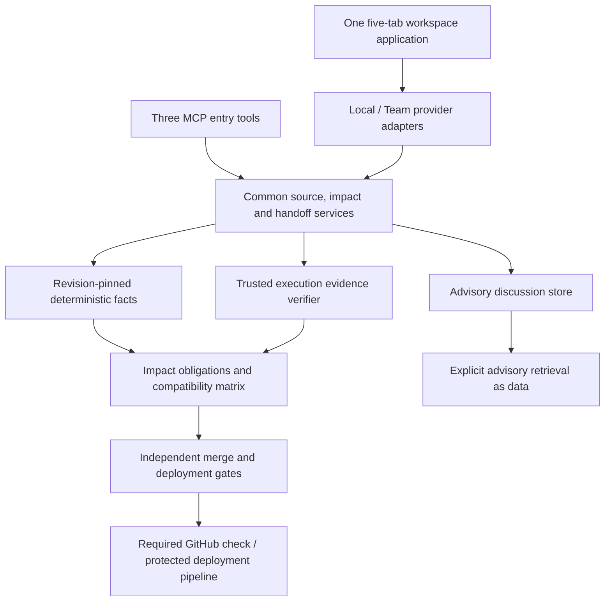

# AIPI trusted cross-repository change and release plan

Reviewed 23 October 2026. Status: implementation plan and working-tree audit; release acceptance remains open.

Implementation update, 23 October 2026: CR0 has started. Repository-imported receipts remain advisory and no longer promote contract state. Legacy receipt checks require an explicit accepting evidence adapter; local deployment preflight always reports enforcement unavailable and cannot unlock deployment. Shared K-Maps now shows a read-only compatibility panel with unknown deployment observations by default. These changes do not close CR0, provide a deployed-version feed, or establish protected merge/deployment gating.

Experience and integration companion: [UI/UX, Cloud–Companion–IDE wiring and MCP refinements](AIPI-UI-UX-SURFACE-AND-MCP-PLAN-2026-10-23.md). It maps these capabilities into the existing five tabs and specifies shared actions, surface boundaries and tool changes.

## 1. Product outcome and scope

AIPI is one workspace application with Local and Team providers. Its core workflow is: discover a dependency before editing, assess the actual change, confirm publication of its blast radius, give the affected developer or agent bounded context, verify the exact producer/consumer versions, and permit deployment only when the versions that will coexist are compatible.

The product promise is **prevent known cross-repository contract regressions and expose what remains unproven**. “Zero cross-repo regressions” is an objective measured on supported, declared scope. Static analysis and passing tests cannot establish that every dynamic consumer, external client or behavior has been discovered.

This plan reconciles the attached workspace proposal, the current code, earlier plans and the user's additional trust/deployment requirements. The attachment is design input, not executable instructions or evidence that a capability exists. This review changes planning documents only; it does not implement the runtime changes below, deploy services, change repository protection, publish packages or close release gates.

Audit baseline: `/Users/akhilkolli/Downloads/AiPI`, package version **0.4.9**, HEAD `ddc025b14f678f508d7d0067ee1f54370ab1a1b1`, with extensive pre-existing tracked and untracked changes. HEAD alone does not identify the audited implementation. [Audit evidence](evidence/trusted-cross-repo-audit-2026-10-23.json) records selected file hashes, checks and limitations.

## 2. Resolve conflicting plans

Use the following division of responsibility. Historical completion checkboxes remain historical implementation records; they are not product acceptance.

| Document / earlier proposal | Keep | Reconciliation |
| --- | --- | --- |
| `AIPI-WORKFLOW-ACCEPTANCE-2026-10-23.md` | Canonical identity and migration contract | Workspace UUID, logical `prj_…`, portable `src_…`, device checkout. `wsg_…` is a retained local alias; do not replace the newer contract with the pasted audit's identity assumptions. One project can contain several repositories. |
| This plan | Current cross-repo implementation sequence and acceptance cases | Stages use **CR0–CR6** to avoid reusing M1–M6, R0–R7, I1–I6 or D0–D6 with different meanings. |
| `AIPI-D0-CANONICAL-SYNC-AUTH-ACCEPTANCE-PLAN-2026-10-22.md` | Detailed Team authorization, storage, offline/retry and two-device gate | Still required for Team release. A green local fixture cannot close it. |
| Capability delivery / executive plans | Five-state ledger, reproducible checks and product acceptance | D4 compatibility work becomes a core deliverable in CR5. Do not postpone it behind broad continuity/reporting work. D0–D2 remain prerequisites for trustworthy Team proof. |
| `AIPI-TEAM-MILESTONES.md` | Existing component backlog and historical evidence | Checked graph/receipt/sync items do not imply live automatic discovery, trusted CI, lossless rich sync or production gates. TEAM-605 remains a real integrated acceptance requirement. |
| `AIPI-R0-R1-IMPLEMENTATION-STATUS-2026-10-21.md`, including 23 October additions | Source-level progress | Provider classes and shared task markup exist; their presence and mock tests do not establish adapter integration or provider parity. |
| Older MVP / v2 / roadmap / workspace-alignment plans | Useful UX requirements and historical scope | Earlier “deployment deferred,” mandatory manual relationship review, project-as-repository and broad UI-first ordering yield to this plan and the newer identity contract where they conflict. Retain compatible accessibility and free-local requirements. |
| Pasted M1/M2 versus M5 choice | Reusable provider, UI and handoff foundations | The choice is incomplete. Start with the trust boundary and source-aware evidence, then close one narrow change-to-release scenario. Do not rebuild existing provider classes or call the current deployment helper a release matrix. |

Decisions resolving the main conflicts:

1. Deterministically established dependencies need no upfront graph review. A human confirmation of an inferred link records advisory intent until a machine check establishes it. Confirming a link never verifies compatibility.
2. A blast-radius acknowledgment authorizes sharing that exact assessment and selected follow-up work. It does not verify the change, grant repository rights, approve a merge or authorize deployment.
3. A merged frontend, completed task, green unrelated test or proposed frontend pass is not evidence that the production frontend is compatible.
4. Advisory decisions may synchronize as discussion records, but cannot enter authoritative agent context, execution policy, check requirements or gate logic through their prose.
5. Keep shared presentation; finish actual provider adapters and workflows. Avoid another navigation redesign before the core loop passes.

## 3. What the current implementation establishes

| Capability | Observed implementation | Missing before the product claim is valid |
| --- | --- | --- |
| Provider contract | `packages/core/workspace-provider.mjs` defines both providers and normalization; its standalone tests pass | No imports/instantiations were found in the inspected local/IDE/Team application entry points. Some URLs anticipate routes not present in those adapters. Add real route contract tests and connect the application. |
| Five-tab application | Shared `ui/workspace-app.js`, task detail markup and synchronized copies exist; local workspace view supplies task detail options | Team dashboard still renders a separate detail section and does not pass selected-task/context options to the shared renderer (`sites/aipi-public/app/team/dashboard/page.tsx:222–225`). Full workflow parity is open. |
| Source identities | Portable source/checkout identities and ambiguity guards are documented and implemented | Legacy graph/impact/context/receipt paths still use project/resource identities inconsistently. Two sources in one project must retain separate pins through every boundary. |
| Incremental extraction | `packages/contract-engine/incremental-index.mjs` already caches derived file results by stat signature/content hash and index version | Authenticated shared fact partitions, source-aware invalidation and complete dependency-boundary changes remain open. Stat reuse is an optimization; authoritative CI facts must validate actual content digests. |
| Sync | SQLite outbox, cursor/snapshot recovery, expanded cached entity types, and graph dispatch exist | Allowed cache entity types do not create server mutation/feed coverage. `syncTeamOnce` has no contract/milestone/handoff mutation dispatch. Graph requests omit the common operation ID/base version, unlike task operations; verify server idempotency before claiming exactly-once publication. The local task reconciler still fingerprints title/status only. |
| Impact and proposals | Bounded graph traversal, selected OpenAPI 3 JSON structural deltas and deduplicated task proposals exist | General semantic discovery, source-aware obligations and stable deduplication across PR pushes are open. Proposal fallback can cite the first unrelated artifact and assign fixed 0.95 confidence (`task-proposals.mjs:128–165`); replace with an explicit unresolved citation. |
| Verification | `verification-coverage.mjs` requires an explicit trusted acceptance callback, exact targets and evidence; reviewed local assessment execution signs receipts | Legacy task/import/deployment paths use weaker receipt conventions. Local HMAC authenticity is not portable Team producer verification. All authoritative paths need the same acceptance rules. |
| Agent context | Bounded context, persistent handoffs and completion checks exist | Raw task/review prose is interpolated into handoff Markdown. Labels saying “untrusted” do not enforce a data boundary. Token counts are UTF-8-byte estimates; the cross-repo ownership manifest can exceed its content budget. |
| GitHub | Signed PR/check webhook ingestion, current-PR assessment and candidate report composition exist | Webhook event allowlist currently contains `pull_request` and `check_run`. Publish route deliberately returns 503. Current-head trusted check publication, merge-group validation and deployment event ingestion are open. |
| Deployment | `evaluateDeploymentGate` checks one project's matching passing receipt, health and linked contract drift | No deployed producer/consumer matrix, active cohorts, artifact binding, rollout serialization or authoritative cross-repo deployment permission. It is a local preflight foundation. |
| Requested MCP facade | Related bounded tools exist under existing names | `aipi_get_cross_repo_contracts`, `aipi_check_impact` and `aipi_get_handoff` were not found. Implement adapters over common services rather than a second graph/check engine. |

### Trust issues reproduced during this review

An isolated temporary fixture wrote an unsigned receipt into `.aipi/verification-receipts.json`, imported it through `hydrateProjectTeamMemory`, and called `evaluateDeploymentGate` with matching source revision and synthetic healthy environment. The helper returned `unlocked: true`. The fixture and its files were removed. This demonstrates a local receipt/preflight trust gap; it does not demonstrate an actual deployment.

`hydrateProjectTeamMemory` also copies repository-controlled contract state and receipt pointers into project state (`team-memory.mjs:101–112`). Its graph-pin helper promotes supplied pins to confirmed/confidence 1. Repository files are evidence inputs, never an authority for producer identity, check success, permissions or policy.

A separate synthetic marker in task/review text appeared in `formatTaskHandoff` output. This establishes prose propagation into the handoff, not that a host placed it in a system prompt or an agent obeyed it. Trace every host adapter to establish actual prompt placement; design the boundary so it cannot depend on model obedience.

Fourteen focused test scripts passed in this review, including provider, shared UI, sync, impact, OpenAPI, proposals, memory, signed assessment evidence and handoff lifecycle. Existing green tests coexist with these gaps because they test different boundaries or explicitly permit legacy behavior. No full-suite, installed-client, live GitHub, production or two-device acceptance is claimed here.

## 4. Target architecture and authority

Keep the companion as the single local persistence/sync writer. IDE and stdio MCP processes delegate mutations to it. Realtime wakes cursor pulls; it never supplies authoritative state. Server writes, accepted operation IDs, feed events and required jobs commit atomically. Immutable fact chunks travel by digest, source scope and version; never rewrite a whole workspace graph as the normal sync operation.

### Four authority classes

| Class | Examples | Allowed use |
| --- | --- | --- |
| Product control | Reviewed workspace policy, configured runner, authorized current user request | Controls permissions and actions through validated application code. A low-privilege repository cannot redefine it. |
| Extracted facts | Operation shape, generated-client/schema digest link, symbol span, dependency lock pin | Typed, revision-bound observations supplied as data. Extraction does not make descriptions, identifiers, defaults, examples or string literals safe instructions. |
| Execution evidence | Verifier-accepted receipt for exact source/artifact/contract/check/environment | Establishes only the recorded check result and scope. A signed irrelevant test does not prove compatibility. |
| Advisory claims | Human/LLM decisions, comments, task prose, review explanations, summaries | Separately stored and explicitly labeled. Omitted from automatic authoritative context and all gate predicates. |

Never concatenate repository-controlled text into system/developer instructions, tool definitions or executable commands. Prefer typed structured tool results for automatic cross-repo facts and receipt references. Free-text advisory retrieval must be explicit, bounded and separately marked; all host rendering treats its values as data. A control-plane task objective must originate from the authorized user's current request or explicit adoption, not a foreign repository's task description. A check can verify a structured claim; it does not promote the whole attached paragraph into authority.

Hashes establish content identity. Signatures establish origin/integrity only when the signer, scope and key are trusted. Neither proves that prose is safe or a test is relevant. Keep local evidence keys outside repositories and repository-controllable configuration. Team independently verifies allowed producer/workflow identity, immutable revisions, artifact digests, result and check/contract scope. Agent-submitted `passed`, producer labels, arbitrary public keys and repository-carried receipts remain claims until that verification succeeds. Do not export local HMAC secrets to make receipts portable.

## 5. Canonical records and invariants

Extend existing models and migrations additively. Proposed record names below describe contracts, not already implemented tables.

| Record | Required identity / content |
| --- | --- |
| `SourceRevision` | workspace UUID, project ID, source binding ID, immutable repository identity, commit; explicit working-state digest for local dirtiness; revision scope (`baseline`, `proposed`, `working`) |
| `FactPartition` | source/file blob digest, extractor/rule version, semantic digest, bounded typed facts, provenance, coverage gaps; content-addressed chunk ID |
| `DependencyEvidence` | qualified producer/consumer references, rule ID/version, exact input digests, evidence class, validation state and freshness; no prose-based trust upgrade |
| `ImpactAssessment` | stable change identity, immutable assessment generation, base/head or working digests, revision set, graph generation, affected references, obligations and explicit unknowns |
| `PublicationAcknowledgment` | actor, assessment digest/generation, selected publication/task actions, policy version, expiry, timestamp and operation ID; source/graph/scope change invalidates it |
| `CompatibilityEvidence` | directed producer version + consumer version + operation/schema hashes + environment/config + check/runner/artifact provenance; five-state coverage and separate compatibility outcome |
| `DeploymentObservation` | source/repository/service, environment/region/cohort, artifact digest and build provenance, commit, observed activation state, monotonic generation and trusted observer; intended/merged versions are separate |
| `ReleasePlan` | immutable candidate artifacts, current deployment generation, complete coexistence obligations, rollout dependency DAG, fallback/rollback constraints and policy digest |
| `GateDecision` | `allow`, `block` or `waived`; exact input digest, reason codes, evidence references, actor/policy, expiry and deployment lease; never a task-status alias |
| `Waiver` | authorized signer/role, exact obligations and source/artifact pair, environment, reason, expiry and audit record; changes outcome to `waived`, never fabricates passed evidence |

Do not conflate relationship certainty, check state and compatibility. Keep ledger states `passed`, `failed`, `missing`, `stale`, `unknown`; compatibility outcomes can be `compatible`, `incompatible`, `unknown`. An “additive” schema delta may still violate a consumer's strict parsing or behavioral assumptions.

Translate legacy `resourceId` to `sourceBindingId` only with an explicit ownership mapping. Backfill an unambiguous primary origin; preserve ambiguous history as unknown. Pins use `(workspaceId, projectId, sourceBindingId)`, not project alone or device paths. Revision, artifact, environment, producer authorization, rule or relevant policy changes invalidate applicability. No timestamp or branch label substitutes for an immutable source state.

## 6. Deterministic relationship discovery

Start with **OpenAPI 3 JSON + FastAPI/Pydantic extraction + a generated TypeScript client with a pinned generation manifest/schema digest**. This matches current useful foundations. A schema alone proves the producer's declaration; it does not prove which service a consumer contacts. Require an authorized source/service binding plus machine-checkable client generation/package provenance or a supported resolved call target.

Automatically accept a supported relationship only when a deterministic rule establishes both endpoints at exact revisions and records its inputs. Environment/base-URL routing remains explicit. Same method/path, matching names, lexical similarity, an LLM assertion or a click are insufficient. Existing manual relationships can support advisory triage and verification proposals without becoming automatic fact authority.

For uncertain links, show Confirm link / Ignore inline in the IDE or PR. Confirm saves a scoped declaration and schedules a supported check; Ignore suppresses that specific suggestion with provenance and expiry. Neither silently changes the deterministic graph. There is no prerequisite trip to Explore to wire the workspace. AST parsers must process syntax without importing/executing the analyzed application; schema resolution is bounded and does not fetch arbitrary URLs.

Expand adapters only after the first ecosystem passes its corpus: GraphQL operation/schema validation and generated client provenance; Protobuf descriptors and generated-client/module pins; tRPC/shared TypeScript package exports, compiler-resolved imports and immutable package versions. Each gets explicit supported/unsupported cases, breaking/additive/internal rules, directional compatibility tests and discovery coverage measurements. Semantic behavior, auth and data migration effects can remain unknown even when schema comparison passes.

## 7. User and MCP workflow

### Before editing, before publishing, and after repair

1. Agent requests dependencies for the selected source/file/symbol, scoped to the caller's authorized workspace and checkout.
2. Companion captures the actual registered Git baseline and working diff; analyzer computes structural deltas, affected deterministic consumers and unknown coverage.
3. IDE/commit UI shows: “This change may affect Storefront checkout. These checks remain unproven. Submitting can share this assessment and create or link repair tasks.” Cite exact versions and paths only where authorized.
4. Offer **Return to edit**, **Save locally**, and **Submit reviewed change with selected follow-up tasks**. Clearly display unresolved impacts and unavailable owners. Only selected, permitted publication actions run.
5. Persist the acknowledgment against the exact assessment digest and revision set. Recompute before publication; changed source, scope, graph or policy requires a fresh review. Git hooks are convenience; server/GitHub gates independently reassess because hooks and agent rules can be bypassed.
6. Create or link one advisory repair task per real consumer obligation; send no automatic messages or invitations. A task does not authorize another repository edit. Consumer agent requests its scoped handoff, repairs within its granted checkout, and invokes configured verification through the existing companion/runner path.
7. Verifier accepts exact producer/consumer evidence; merge and deployment decisions are recalculated separately. Sharing an unresolved assessment never converts missing or unknown checks to passed.

Use two identities for deduplication: a stable coordination key such as `(workspace, origin repository ID + PR number, producer contract, consumer source + target, rule family)`, and an immutable assessment key including base/head/digests/rule version. A push updates the existing coordination task and appends a new assessment. Keying tasks only by `baseSha...headSha` would create new tasks on every push. Local changes retain a stable local change ID; resolve it to a PR explicitly. Never invent a file citation when an endpoint cannot be resolved.

### Three public MCP entry tools

| Tool | Contract | Result / boundary |
| --- | --- | --- |
| `aipi_get_cross_repo_contracts(file_or_symbol)` | Also require or unambiguously resolve workspace, project/source binding and checkout revision | Typed producer/consumer refs, supported evidence, freshness, unknowns and citation/chunk refs; no advisory prose promoted to instructions. |
| `aipi_check_impact(git_diff)` | Resolve an actual diff from registered local Git state; if diff text is supplied, bind it to verified base/head/blob digests or return a preview-only result | Assessment ID/hash, affected consumers, obligations, proposed/deployed compatibility and publication-review requirement. Read-only; no automatic commit, upload or deployment. |
| `aipi_get_handoff(issue_or_pr)` | Resolve provider repository ID + issue/PR number within authorized workspace; pin current assessment and consumer source | Bounded structural changes, contract expectations, consumer citations, exact revision set, trusted receipt refs, unknowns and continuation references. Advisory discussion is opt-in. |

Keep existing verification/job/receipt tools internally: three entry tools do not remove the write-back proof path. Agents request checks; they cannot mint trusted receipts. Version the facade and reuse common services used by the UI and GitHub worker. Rule files such as CLAUDE.md or editor rules can guide supported hosts after an explicit reviewed installation, but cannot guarantee automatic calls or substitute for server enforcement.

Enforce the final serialized response budget, including metadata and revision manifest. Use a supported tokenizer or a documented conservative bound, retain mandatory pins/trust labels/unknowns, paginate optional content, and return a bounded manifest/continuation or explicit too-large error when required metadata cannot fit. Never drop source pins to claim an 8k limit. Measure actual retrieved/executed task cost; no “zero grep” claim when facts are missing, stale or unsupported.

## 8. Separate merge and deployment gates

The merge check answers whether the candidate integrates under the workspace's explicit compatibility policy. The deployment gate answers whether the exact artifact can coexist with the versions currently serving traffic and every intermediate rollout state. Acknowledgment, open repair task, merged PR and healthy URL answer neither question.

For a breaking change, require trusted downstream compatibility evidence for the intended version set or a scoped signed override. Default deployment policy requires accepted current evidence for every required coexistence pair. Failed, missing, stale, unknown, unresolved consumer inventory, untrusted deployment state or inaccessible evidence blocks strict deployment. An authorized waiver is visible as waived and expires; the underlying ledger is preserved.

### Example release matrix

| Producer / consumer | Frontend F0 deployed | Frontend F1 proposed |
| --- | --- | --- |
| Backend B0 deployed | Existing accepted pair | Must be checked if frontend deploys first |
| Backend B1 breaking candidate | **Incompatible: deployment blocked** | Can pass while B1 deployment remains blocked |
| Backend B1-expand, retaining old behavior | Must pass | Must pass before migration |

Safe default rollout: deploy backward-compatible backend expansion, deploy a frontend that works throughout the transition, establish trusted activation of the supported frontend cohorts, then remove the old backend contract in a later release. Do not assume arbitrary frontend-first ordering works. A cyclic dependency or lack of any compatible intermediate state requires expand/migrate/contract, a controlled atomic cutover with verified routing, or a scoped waiver; a task DAG alone cannot make independent deployments atomic.

Track production separately from staging; regions, canaries and concurrently active versions separately; artifact digest separately from commit; and deployment intent separately from successful activation. Account for cached browser/mobile/long-lived consumers using an explicit supported-version policy and retirement boundary. A merged frontend or a recently served bundle cannot prove every old browser is gone. Observability is supporting evidence with sampling/age gaps, not complete absence proof.

### Enforce at the actual release boundary

Re-read trusted deployment state and authorization just before granting an expiring decision bound to candidate artifacts and deployment generation. Serialize/reserve affected release scope, atomically check expected generation, and invalidate/recheck when another deployment or rollback changes it. Independent repository workflow concurrency is not a cross-repository lock. If the deployment controller cannot honor the lease/generation contract, do not claim race-safe enforcement.

Ingest authenticated deployment/activation and rollback observations with idempotent event identities. Ignore stale out-of-order events; reconcile missing events against the authoritative deployment system. Gate each rollout transition, record completion, and evaluate rollback compatibility as well as forward deployment. Loss of the authority or unknown state blocks strict release rather than reusing a stale allow.

GitHub required checks need repository rulesets/branch protection; a PR comment alone cannot block a merge. Validate the current head and, where used, the merge queue's synthetic head, rather than carrying forward an earlier PR pass. [GitHub merge queue documentation](https://docs.github.com/en/repositories/configuring-branches-and-merges-in-your-repository/configuring-pull-request-merges/managing-a-merge-queue) requires `merge_group` integration for required checks.

For deployment, use a protected pipeline/environment boundary and deployment-controller credential policy that cannot skip the decision. GitHub App custom deployment protection can provide that boundary where available; it is currently preview, available for public repositories and requires Enterprise for private/internal repositories. Provide a protected CI/controller integration for other supported installations; a skippable CLI step alone is advisory. [Custom protection rules](https://docs.github.com/en/actions/how-tos/deploy/configure-and-manage-deployments/create-custom-protection-rules), [deployment controls](https://docs.github.com/en/actions/how-tos/deploy/configure-and-manage-deployments/control-deployments). Feature availability must be rechecked at implementation time.

## 9. Permissions, sync and restricted dependencies

Apply workspace role, source grant, sharing policy and current repository/App authorization to fact retrieval, contexts, jobs, receipts, matrix reads and mutations. Source-binding ownership is validated transactionally. A workspace editor cannot configure a high-privilege runner or sign a waiver merely by controlling one repository. Runner execution uses centrally reviewed command definitions and isolated least-privilege environments; executing code under test remains an untrusted-code boundary.

A gate service may evaluate the complete authorized release scope without disclosing every dependency to the requesting user. Return a generic restricted verification requirement when policy permits; never disclose hidden repository names, paths, symbols, task bodies, counts or topology. Even existence of an edge is sensitive: explicit disclosure policy is required for a redacted dependency stub. Where it is absent, show only a neutral incomplete-scope result. If the service lacks permission to evaluate a required source, the result is unknown and blocking under strict policy.

Repository-derived context and decisions need the same broker checks as source reads. Audit direct SQL/RPC, snapshots, change feeds, artifact storage, exports and already connected Realtime clients; pruning only the Explore graph is insufficient. Revocation stops subsequent reads, queued publication and future execution; quarantine unauthorized Team caches without deleting private local work. Previously downloaded bytes cannot be revoked retroactively.

Extend durable sync for fact manifests/partitions, dependency validations, assessments, coordination tasks, handoffs, deployment observations and gate records. Each type needs mutation authorization, server operation deduplication, tombstones where applicable, cursor/snapshot representation and transactional application tests. Use source-scoped chunk retrieval and bounded neighborhoods. Advisory data may converge but remains advisory across every cache and reserialization step.

## 10. Implementation sequence and acceptance

CR stages are gates, not calendar estimates. Narrow local implementation can progress without live Team credentials; production Team enforcement waits for the D0 matrix and live integration evidence. Build the release-record contracts in CR1 so CR5 does not require another identity migration.

| Stage | Concrete implementation work | Acceptance gate | Existing-plan mapping |
| --- | --- | --- | --- |
| **CR0 — close authority gaps** | Unify receipt acceptance; quarantine repository memory claims; separate advisory handoff content; reject prose-driven policy/commands. Change legacy deployment preflight so a self-authored receipt cannot unlock it. Add focused adversarial coverage. | Unsigned/imported/forged/wrong-scope receipts, fake producer labels, malicious contract descriptions/reviews and repo configuration cannot grant proof, execution or publication authority. Valid reviewed runner evidence still works. | D0 trust + D1/D2 proof prerequisites |
| **CR1 — source-aware common services** | Finish canonical source pins and additive mappings across graph/contracts/context/receipts; connect actual provider adapters/routes; implement lossless rich sync and operation IDs for all new mutations. Add real provider-route integration tests to normal CI. Preserve one local writer. | Two repositories within one project and monorepo subfolders retain distinct revisions; legacy ambiguity stays explicit; two device stores converge after retries/conflicts without losing fields or pending work. Local/IDE/Team read the same authorized projection. | I4/I5, R0/R1/R3, D0 |
| **CR2 — one deterministic ecosystem** | Incremental OpenAPI/FastAPI/generated-client extraction, machine-verifiable cross-source links, contract deltas and partition sync; unsupported/dynamic coverage explicit. Remove unrelated proposal citations. | A real producer field removal finds the generated-client consumer without manual wiring; one-file edit only re-extracts needed partitions; rename/delete/regen/rule changes invalidate correct edges; independent labeled cases include misses and false positives. | D1; earlier M3/M4 |
| **CR3 — reviewed impact and MCP repair** | Three facade tools, assessment-bound publication review, stable coordination keys, scoped handoffs and bounded retrieval; reuse current jobs and runner verification. Wire shared task/assessment detail through all surfaces. | Duplicate/pushed PR events retain one coordination task; stale acknowledgment is rejected; another authorized agent repairs the consumer from current bounded context and returns exact-version evidence. Advisory text stays quarantined. | D1/D2 and narrow D3; earlier M5 |
| **CR4 — trusted GitHub merge loop** | Trusted CI producer verification and artifact binding; idempotent current-head Check Runs; required-check setup diagnostics; refresh/rebase/base-change/merge-group handling; scoped override audit. | A real two-repo PR is blocked for missing/failed/stale proof and passes only with accepted intended-version evidence or explicit visible waiver. A forged check, old head, fork payload or repository-controlled workflow cannot forge trusted producer identity. | R4, D5 publication subset |
| **CR5 — compatibility and release gate** | Deployment observations, directed pair matrix, release DAG/coexistence obligations, leases/generation checks, protected controller integration, forward/rollback decisions and waivers. | Proposed frontend pass leaves breaking backend blocked against deployed frontend. Expansion/migration permits each compatible step. Concurrent releases, stale/out-of-order events, old cohorts, rollback and revoked evidence cannot reuse an allow. | D4 promoted into core release scope |
| **CR6 — installed product acceptance** | Full D0 live matrix plus packaged companion/IDE/Team journeys, current App permissions, protected real deployment fixture, outage/recovery and measurable task economics. Keep existing trial/export/billing release obligations. | Real supported agent, two users/devices, no hidden-source leak, offline retry convergence, current-head check, blocked incompatible deployment, compatible rollout and traceable receipts; no skipped required gate labeled complete. | TEAM-605, I6, D0–D5 integrated release |

### First reviewable implementation batch

1. **CR0.1** `team-memory.mjs`: preserve imported data as scoped claims; stop assigning authoritative receipt/contract state from repository JSON. Preserve old data through additive migration/quarantine.
2. **CR0.2** `assessment-proof.mjs`, `verification-coverage.mjs`, `deployment-gate.mjs`, runner adapters: define one accepted-evidence interface. Reject unsigned or unrecognized evidence in every gate path; retain explicit legacy/unverified display and avoid treating local preflight as cross-repo permission.
3. **CR0.3** `task-context.mjs`, `handoff.mjs`, local/remote MCP/context adapters: introduce typed facts/receipt refs and a separate opt-in advisory channel; ensure source text cannot populate instruction templates or check commands. Enforce final payload budget with mandatory provenance retained.
4. **CR0.4** Add adversarial regression tests and run existing assessment, coverage, handoff, memory and release-intent suites. The current release-intent test's synthetic unsigned receipt success is legacy behavior to revise, not a gate to preserve.
5. **CR1.1** Define source-aware `CompatibilityEvidence`/`DeploymentObservation` contracts and mapping tests. Then wire a provider method at a time against its real route before removing the legacy caller.

This batch is intentionally small enough for code review. It establishes trustworthy inputs before automatic publication, PR blocking or deployment permission is enabled. It is the recommended start, rather than re-extracting a provider already present or calling a single local handoff fixture complete product acceptance.

## 11. Release-defining acceptance scenario

Use Orders (FastAPI/OpenAPI), Storefront (generated TypeScript client) and a third restricted/unknown consumer. Discover the Orders–Storefront link through extraction and generator provenance, not a seeded manually approved edge. Run separate device stores and actual installed clients for final acceptance.

1. Trusted deployment observations establish Orders B0 and Storefront F0 in production, with artifact provenance and a current accepted pair.
2. B1 removes a response field used by F0. Before publication, IDE/MCP exposes the exact structural change, consumer citation and unproven checks.
3. User acknowledges the current assessment and chooses task publication. An intervening source edit invalidates that acknowledgment. Retrying the same publication creates no duplicate task.
4. GitHub recomputes the pinned PR assessment. Missing or forged evidence blocks its required check. A signed override is distinct from a pass and expires.
5. Consumer agent fetches a scoped bounded handoff, implements F1 and returns accepted B1/F1 verification. A prose instruction hidden in a schema description or review never changes permissions, command selection or authoritative context.
6. With F1 still proposed or merely merged, B1/F0 remains incompatible and B1 production deployment is blocked. Staging success does not satisfy production obligations.
7. Produce B1-expand retaining the old contract; prove its pairs with F0 and F1. Deploy expansion, migrate frontend cohorts, then consider a separately checked backend contraction. Pending repair tasks stay visible until their actual obligations are met.
8. Exercise an old browser/canary cohort, an intervening deployment, rollback, lost event, duplicate webhook, expired lease and source-permission revocation. None may reuse an obsolete allow.
9. Restricted user sees only an authorized generic incomplete-scope result, with no hidden names/citations/counts. Full-access gate execution retains the required obligation.
10. Interrupt/reconnect both devices; confirm shared IDs, immutable receipts and acknowledgments converge, local private changes remain local, and no advisory claim becomes authoritative during serialization or replay.

Record exact dirty-source snapshot/release revision, installed versions, migrations, producer identity, artifact and contract digests, source revision sets, policy versions, event ordering, checks, outcomes and limitations. Measure missed consumers/false positives, time to accepted fix, task deduplication, total retrieved tokens and total cost per accepted task. Component test success, a Markdown plan or a signed but irrelevant receipt cannot substitute for this scenario.

## 12. External implementation constraints verified for this plan

GitHub merge queues validate synthetic heads and require appropriate merge-group checks; custom deployment protection is a distinct environment integration with availability constraints. The sources linked in section 8 were checked during this audit. MCP annotations are hints and cannot enforce prompt-injection resistance or authorization; use application/host boundaries and isolated runners. [Official MCP discussion](https://blog.modelcontextprotocol.io/posts/2026-03-16-tool-annotations/).

The defensible first release is one supported deterministic ecosystem with trusted, exact-version proof and an enforced production compatibility gate. Broader language/framework support, autonomous milestones, reporting and additional dashboard features follow measured acceptance of that loop.

## 13. Implementation checkpoint (2026-10-23)

The first local trust and UI slice is implemented. Agent handoff text and the default context manifest omit task/review prose; the three read-only MCP facade tools use scoped, bounded responses. A handoff can complete only after a matching local verification run. Repository-imported receipts and graph pins stay advisory, caller-submitted receipts remain unverified, and unauthenticated OTLP observations cannot confirm runtime edges. Impact proposals no longer substitute unrelated citations.

Local, IDE and Team render the shared Compatibility & rollout panel. The local provider now serves a workspace-scoped compatibility preview; Team returns an explicit unavailable state. The pure compatibility evaluator checks exact candidate/deployed-consumer pairs, ignores proposed versions, requires accepted proof/observation callbacks and always returns `canDeploy: false`. There is no production deployment observation feed, protected controller, current deployment generation, or enforced release decision yet. A passing unit fixture is only a preview result.

The full repository test suite, local build and Team web build passed for this checkpoint. New adversarial handoff and release tests also pass; they are included in the workspace test script. CR0 still requires a uniform acceptance service and stronger producer integrity for local verification runs. CR1–CR6 and the live two-repository installed acceptance scenario remain open. Do not configure this preview as a required production deployment gate.

### Next local publish increment

The companion Git publish review now computes a read-only assessment for every local workspace containing the publishing project, compares the tracked target branch with the exact outgoing commit, and displays cited downstream components plus unknown coverage. The server issues a five-minute acknowledgment token bound to the commit, destination, workspace membership, current source/revision snapshots and impact result. The publish endpoint recomputes the review and rejects a missing, expired or changed acknowledgment. Users may opt into deduplicated *proposed* downstream repair tasks after a successful push; uncitable consumers remain unresolved for manual follow-up.

This closes only the local pre-submit disclosure path. Its file/index graph can miss consumers, the local remote-tracking ref can be stale, and another repository can change between assessment and push. The token records an acknowledgment, not accepted compatibility proof or a signed waiver. GitHub required checks, current PR/merge-queue heads, protected CI producer identity, Team-wide task delivery and the production deployment controller remain required for the zero-regression and deployment promises.

Team Cloud now exposes an authenticated, workspace-scoped compatibility read endpoint. The shared Team provider loads it for the K-Maps panel and receives an explicit unknown/unavailable result. It checks workspace visibility and selected project membership before responding, but it has no trusted observation/proof store or deploy decision endpoint. The Cloud route is an honest capability boundary, not a simulated release gate.

### Source identity and sync correctness increment

Workspace targets now carry a workspace ID and, when resolvable, a stable source-binding ID, exact source revision, content hash, analyzer version and evidence kind. Multiple unnamed roots remain incomplete rather than inheriting one project's primary source identity. Change-assessment revision pins prefer source bindings over local root IDs. Pending or inferred graph edges are excluded from indexed dependency detail; reviewed declarations remain labeled advisory. Existing target keys are retained for saved selections, so this is an additive provenance change, not a complete identity migration.

Incremental indexing now hashes file bytes before reusing a cached extraction, including files whose size and timestamp have not changed, and skips files resolving outside the registered root. This closes a stale-fact path while retaining result reuse for unchanged hashes.

The graph-review outbox uses the cloud route's `confirm` field and validates the returned edge ID and state before marking the operation accepted. The outbox rejects contract, milestone, handoff and unsupported graph writes that have no corresponding cloud operation, instead of retaining permanently undeliverable writes. Partitioned fact sync, protected proof producers, current-head GitHub required checks and the release controller remain open.

Validation for this increment: the full `npm test` suite, `npm run test:package`, IDE extension build, Team web build, and the three-repository verified-change fixture pass. The fixture's final coverage ledger remains `unknown` by design: some consumer links are seeded, and it does not exercise Team sync, repository permissions, a real agent or GitHub PR evidence.

### Next Team mutation increment

Graph reviews now use a versioned broker operation. The cloud broker checks the current editor/device and source grants, binds an operation ID to the requested edge/state/base version, stores a durable acknowledgment, and rejects a stale base version or changed endpoint revision before changing the review. An acknowledgment lost in transit can be retried without repeating the mutation. The graph read includes the edge version so a client can submit the version it actually reviewed. A pgTAP retry/conflict test is included. This is a review-write safety improvement; graph facts and reviews are not yet in the source-scoped change feed or snapshot, and full-schema Supabase acceptance is still pending.

New Team task, evidence and receipt revision sets accept explicit `sourceBindingId`. Database guards validate that each source belongs to the referenced project and workspace. Legacy project-only revisions are accepted for new writes only when that project has exactly one active source binding. Existing historical rows remain unchanged, including when another task field is edited. These records still require producer-authenticated proof before they can satisfy a merge or deployment gate.

The full repository suite, type-check, cloud Worker smoke and package smoke pass after these changes. The combined SQL bootstrap was regenerated from 49 migrations. Both new migrations were executed in an isolated PostgreSQL 17 database with minimal dependency tables; direct execution confirmed first-write/duplicate graph-review acknowledgments, stale-version rejection, and single-source versus ambiguous multi-source revision validation. The full Supabase schema, RLS policies, triggers, and pgTAP matrix have not run because Docker-backed Supabase was unavailable in this workspace. Those remain an acceptance gate.

The Team PR report now bounds and escapes repository-derived labels, check names and source references before building Markdown, and labels source citations unverified. A forged newline or HTML fragment cannot create a false report row. This is presentation hardening; it does not establish the trustworthiness or relevance of the underlying check.

The Team PR report now rechecks the current GitHub PR base and head before returning the saved report. A push that arrives before its webhook makes the report unavailable with a stale-revision conflict instead of presenting an old result. This does not yet cover merge-queue synthetic heads or publish a required GitHub Check Run.

### Source partition and fail-closed GitHub check increment

Team Cloud now indexes bounded OpenAPI 3 JSON from an exact GitHub commit into immutable, source-binding-scoped fact partitions. The broker fetches the file itself and rechecks the caller's current GitHub installation, repository grant and linked identity on every index/read. Only structural operation identifiers and hashes are persisted; descriptions and examples are excluded from extracted facts. Direct authenticated PostgREST access is denied, and these partitions are excluded from organization-wide snapshots/changes. The Team provider exposes explicit index/list calls, while the companion has a separate SQLite source-fact cache and pull operation that verifies fact hashes, preserves the previous cache on a corrupt page, and evicts a source's cache when its repository grant is denied. This is an initial OpenAPI partition path, not a complete changed-blob manifest, AST/GraphQL/gRPC/tRPC fact pipeline or automatic all-device convergence feed.

Team Cloud can also index a bounded `aipi.generated-client.json` manifest after fetching and hashing each listed generated file at the exact consumer commit. An exact-pin matcher returns candidate consumers only when workspace, producer source binding, producer commit, content hash and operation ID agree. The discovery endpoint rechecks access to each source before returning its candidates; its `discoveryComplete` flag remains false because unindexed or inaccessible sources may contain more consumers. Manifest claims remain advisory even when their files match; generator attestation, complete dependency coverage and independent compatibility proof are still required.

The source-fact cloud route test confirms the Worker extracts from pinned GitHub content instead of client-supplied facts, excludes repository prose from the stored partition, and returns 403 after the GitHub repository grant is revoked. A separate local cache test confirms hash validation and eviction after denied source sync. These are controlled mocks; installed revocation and two-device convergence still need live acceptance.

Signed GitHub PR and `merge_group` webhooks for mapped repositories now publish a Check Run named `AIPI / cross-repo release` on the event head. The publisher requests a repository-scoped installation token with `checks:write`, looks up its own check by external ID and updates it on retries. The check concludes `failure` because exact cross-repository evidence and protected release decisions are not yet available. A repository administrator must still configure this name as a required check from the AIPI App in branch protection/rulesets; this code does not alter protection settings. No success path or override is implemented, so this check must not be configured as required for production until the trusted CI proof and release controller paths are complete.

The repository test suite, package smoke and type-check pass for this increment. The source-fact SQL migration, including its generated-client analyzer and source/project foreign key, applied in the isolated PostgreSQL 17 dependency stub. A read-only linked-project check found migrations `20261023030000`, `20261023031000` and `20261023032000` still unapplied in the AIPI-Team Supabase project. Docker-backed Supabase, real GitHub App installation/permissions, two-device access matrix and protected deployment acceptance remain untested here.

### Controller-observed cohort increment

The protected-controller API now accepts timestamped HMAC-signed requests with a five-minute window. A service-only Postgres operation records exact source binding, project, commit, artifact digest and cohort activation/retirement. It serializes an environment generation and deduplicates event IDs; retrying an identical event returns the original acknowledgment, while an intervening rollout or reused ID conflicts. The controller state route checks the generation before and after reading cohorts and asks callers to retry if the snapshot moved. A decision request reports `stale` when its expected generation changed and otherwise reports `unknown` with `canDeploy: false`: accepted coexistence proof and complete consumer discovery have not been implemented. No deployment lease or allow result exists. This is a protected observation and blocking interface, not a deployable release gate.

The new migration `20261023124345_deployment_cohort_control.sql` applied to the isolated PostgreSQL 17 dependency stub. Direct SQL calls confirmed first event, duplicate acknowledgment, generation conflict and a subsequent event at the new generation. Signed-route tests cover observations and the blocking decision. The generated bootstrap now contains 51 migrations. The linked AIPI-Team Supabase project remains behind this checkout; no migration or Worker deployment was performed against it.

Controller integration contract: configure a private Worker secret named `AIPI_DEPLOYMENT_CONTROLLER_SECRET` with at least 32 characters and keep it outside repository workflows that untrusted contributors can edit. Each POST signs `${timestamp}.POST.${pathname}.${body}` with HMAC-SHA256 and sends the 13-digit millisecond timestamp in `x-aipi-controller-timestamp` plus `sha256=<hex>` in `x-aipi-controller-signature`. The controller calls `/state`, then `/observe` with a UUID event ID and exact expected generation. `/decision` is currently blocking for every candidate and must remain so until accepted pair proofs, complete discovery, a lease, and a protected pipeline are in place. Neither a source contributor nor a normal Team session can write observation tables directly.

The Team read-only compatibility endpoint now includes fresh controller-observed cohorts only for sources the signed-in user can currently read through GitHub. It omits inaccessible source names, versions and even a source-specific restricted flag; the generic discovery-incomplete state remains. The shared panel can show authorized observed versions, but missing discovery and proof keep its deploy action unavailable. A route test covers the restricted-source case; installed two-user verification is still open.

Read-only GitHub API checks on the private `AIPI-AI-Programming-Interface/AIPI` repository returned HTTP 403 for rulesets and branch protection with GitHub's "Upgrade to GitHub Pro or make this repository public" response. Required-check enforcement cannot be accepted on that repository under its current plan/visibility. The App installation permissions could not be verified with the user's OAuth token. No live PR, merge-queue or protected deployment acceptance is claimed.
