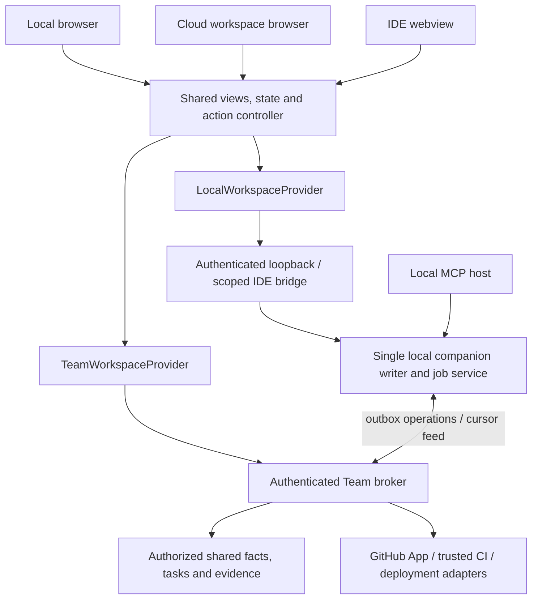

# AIPI UI, cross-surface wiring and MCP refinement plan

Date: 23 October 2026. Status: staged implementation; the full workflow and live release gate remain open.

Implementation update, 23 October 2026: the shared K-Maps renderer now includes a read-only Compatibility & rollout panel with explicit unknown observations and enforcement state, synchronized into Local, IDE and Team assets. Repository-imported receipts are advisory, and local deployment preflight cannot grant release permission. The panel has no live deployment-observation or pair-proof feed yet; the three daily MCP facade tools and reviewed publication flow remain planned. In the current checkout, Team task detail already uses the shared renderer, so UX work should extend that path rather than build a second task detail.

Implementation started: Team now opens tasks in the shared five-tab detail instead of a duplicate Team panel. Its task context, status changes, creation and comments use `TeamWorkspaceProvider`; the shared detail shows all canonical task statuses, distinguishes reported receipts from accepted proof, and states when Cloud handoff needs a companion or IDE. A Team refresh retains a PR assessment only while the observed PR head matches its assessed head. This is an initial UI/provider slice; publication review, check jobs, compatibility pairs and the MCP facade remain to be implemented.

Companion to the [trusted cross-repository release plan](AIPI-TRUSTED-CROSS-REPO-RELEASE-PLAN-2026-10-23.md). The [workflow acceptance contract](AIPI-WORKFLOW-ACCEPTANCE-2026-10-23.md) continues to own identities and migrations. This plan owns placement, journeys, shared presentation, surface adapters and tool refinements. It supersedes older four-tab IDE references and any UX that treats a confirmed relationship, completed task or acknowledgment as verification.

## 1. Product decision: keep the five tabs

Keep **Home, Explore, Tasks, K-Maps and Tools**, in that order. Add capabilities inside their existing owners. The user works on a change and its consequences; they should not have to choose a separate impact product, agent product or release product.

| Existing area | Updated purpose | Main action | Reuse / change |
| --- | --- | --- | --- |
| **Home** | Prioritized work: changes requiring review, consumer repairs, blocked releases and current sync/runner issues | Continue the next concrete action | Replace count-only emphasis with a short actionable work list. Keep workspace/project inventory secondary. |
| **Explore** | Understand source and a specific proposed/working change; inspect affected consumers and unknowns | Assess change / Review impact | Extend current explorer and assessment modules into one canonical assessment detail. Link citations to source at the assessed revision. |
| **Tasks** | Own consumer repair, bounded agent context, check execution and proof | Prepare handoff / Review checks | Use one shared task detail across all surfaces. Preserve existing milestones and task editing. Show linked origin change and release obligations. |
| **K-Maps** | Inspect contract dependencies and version compatibility | Inspect contract / Inspect blocked pair | Add local views **Contracts & dependencies** and **Compatibility & rollout**. The graph and an equivalent accessible table describe the same facts. |
| **Tools** | Operate connections, indexes, runners, API tools and diagnostics | Resolve a specific unavailable capability | Wire working actions instead of informational cards. Keep existing request runner and environments reachable; avoid rebuilding them. |
| **Workspace settings** | Projects/sources, access, sharing policy, GitHub, deployment targets and commercial settings | Connect or configure a resource | Reachable from chrome; not a sixth workspace tab. Preserve the current General route until additional settings panels actually work. |

Use one reusable **assessment detail** from Home, Explore, Tasks, K-Maps and GitHub links. Use one reusable **task detail**, **verification review**, **receipt inspector**, **publication review** and **compatibility pair inspector**. Deep links select these objects inside their owning tab instead of creating duplicate screens.

## 2. Shared application shell and scope

The chrome identifies workspace, Local/Team mode, project focus and connection state. Project is a logical application/service; a source binding is its repository/folder/external endpoint. Show source selection when a workflow needs it and more than one authorized source exists. Put raw IDs, full hashes, analyzer versions and device paths in expandable provenance details. Human-readable names and abbreviated immutable revisions stay visible.

Revision selection uses **Working changes**, **Pull request / branch change**, and **Shared baseline**. A branch name is a selection aid; resolve it to immutable commits before assessment. Cloud without a companion cannot select unpublished working files. Environment selection appears in compatibility/check workflows and is retained in their links; it should not look like a global setting that changes all source interpretation.

Changing the project filter changes focus, never the safety scope. A change in Orders still shows an affected Storefront row under “Also affected outside this project.” Counts and gate decisions cannot silently exclude cross-project obligations. If permissions prevent disclosure, use a generic incomplete-scope reason without hidden names, counts or topology. Do not render zero affected consumers when the actual state is unknown.

Keep workspace/source/task/environment selection through navigation, OAuth and reconnect. Cancel or generation-check in-flight requests on a workspace/account switch. Never display a previous workspace's late result under the current workspace name. If an IDE file belongs to several mappings, show the choices; do not silently switch the active task or authorize another root.

Suggested object-link contract, mapped onto existing routes:

```text
Cloud: /workspace/<UUID>?view=explore&assessment=<id>&generation=<n>
Cloud: /workspace/<UUID>?view=tasks&task=<id>&section=checks
Cloud: /workspace/<UUID>?view=kmaps&release=<id>&environment=production
Local: /workspaces/<wsg-alias>?view=explore&assessment=<id>&generation=<n>
IDE:   versioned openObject message with the same qualified object reference
```

These query/message contracts are proposed. Existing project URLs and IDE hashes remain compatible. Every resolver verifies workspace membership and source ownership; possession of an object link grants no access. A different explicitly selected Team workspace requires a reviewed identity mapping; promotion must not silently replace a workspace UUID.

## 3. Screen and interaction contract

### UX01 — Home: a work queue

Show a short ordered list: impacts awaiting publication review, assigned repair work, failed/missing checks, incompatible release candidates, and connection issues that prevent the next action. Each item contains the change/task, affected source, current reason and one primary action. Refreshing or sorting the list does not replace the user's selected detail.

Show **Merge check** and **Deployment gate** independently when relevant. A pending task, PR merged state or healthy service never produces a general “Safe” badge. Keep the existing “What remains unproven?” summary compact and scoped to the selected change; open its detail rather than duplicating the full ledger on every tab.

### UX02 — Explore: source and change assessment

Provide source/project, comparison selection and an Assess change action. Reuse current staged/unstaged/combined/commit comparison capabilities through a shared controller. Cloud offers authorized current PRs; companion offers registered working changes and commits. Source unavailable, unsupported format and ambiguous source are explicit results.

The detail opens with a structural change, such as “Orders response removed `total`,” then producer/consumer citations, dependency evidence, required checks and unresolved discovery. Use plain labels **Breaking candidate**, **Additive candidate**, **Internal change**, or **Effect unknown** until compatibility is established. Selecting a row opens the exact before/after contract or pinned source span, with accessible textual diff as well as highlighted code.

Use **Review sharing & follow-up work** for the publication action. Assessment itself reads local/indexed state; it does not upload working files, create tasks or invoke a runner.

### UX03 — Publication review sheet

One review covers the exact publication operation. Desktop uses a side sheet/dialog; narrow IDE/mobile layouts use a full-width step with a clear return path.

Show the source revision/diff summary, known affected components, explicit unknowns and the exact metadata/artifacts selected for sharing. Show existing related tasks before offering new task proposals. Let the user choose create/link, target owner when authorized, or leave a visible unassigned proposal. Do not automatically message people or execute consumer repairs.

Actions: **Return to edit**, **Keep local**, **Share assessment**. Task creation is an explicit selection within the review. If a Git publish/PR operation is supported, name it separately and include its actual effect in the final action label; “Share assessment” alone cannot imply commit, push, merge or deployment.

Record acknowledgment against assessment generation/digest, revision set, sharing selection and policy. An existing valid acknowledgment is reusable for that exact retry. If any relevant input changes, show **Change updated — review again** and explain the changed scope. Never accept a model-provided boolean as evidence that a person reviewed the sheet. Unknown network outcome becomes “Checking whether this was shared”; reconcile by operation ID before offering retry.

Copy example: “Storefront checkout may be affected. Its required behavior check has not run. Share this assessment and create the selected repair task?” Supporting text: “Sharing records the unresolved impact. Merge and deployment checks remain independent.”

### UX04 — Tasks: repair workbench

Use one task detail with local sections **Work**, **Context**, **Checks**, **Activity**. Work shows the user-adopted objective, owner, origin PR/change and scope. Context shows structured contracts, relevant citations, current context generation, freshness, omitted content and an explicit advisory-discussion disclosure. Checks shows obligations/results. Activity shows task, handoff, publication and runner events with provenance.

Keep task status separate from verification: a manually completed task can still have unknown compatibility, and a passing receipt need not mean the task's human acceptance is complete. The shared status picker includes the canonical states, including proposed/archived, and respects actual write capability. Linked releases expose their blockers but do not auto-close from task status.

An affected consumer that cannot be resolved gets a visible “Source citation unresolved” state and discovery work. Never attach the first available file to create the appearance of grounded context. Preserve existing tasks during deduplication; subsequent PR pushes append new assessments and update the existing coordination task.

### UX05 — Agent handoff

Separate **Prepare context** from **Send to agent**. Preview the exact source scope, bounded fact/check references, unknowns, size, target agent and available adapter. User-authored current instructions remain separate from foreign task prose. Advisory notes are omitted by default from automatic agent context.

Show observable delivery states: **Prepared**, **Opening agent**, **Chat opened**, **Agent acknowledged** when the adapter can prove it, **Working**, **Blocked**, **Verification pending**, **Verified at these revisions**. A copied file or clipboard fallback says **Saved / copied — open your agent to continue**. It cannot be labeled sent, accepted or completed. Retry uses the same handoff/context generation unless refresh is explicitly requested.

In Cloud, offer **Open in connected companion** or an authorized remote-agent capability only when actually present. Do not imply a browser can edit a local checkout. In IDE, open only citations inside the explicitly trusted registered roots. Connecting a missing consumer checkout is an actionable step, not permission to bypass the root guard.

### UX06 — Review and run checks

Before execution show each required check, why it applies, producer/consumer versions, environment and runner. Expand technical details for command/arguments, working directory, timeout, network/state-change scope and plan fingerprint. Existing authorization can cover the unchanged reviewed plan; do not repeatedly prompt for read-only navigation or polling.

User sees **Run reviewed checks** only for a permitted runner. Otherwise show **Connect a companion**, **Select CI runner**, **Configure check**, or **Request execution access**, with the actual reason. A different source/configuration/command invalidates execution authorization and explains why another review is needed.

Progress persists by job ID, reconnects after navigation/restart and distinguishes queued/running/cancel requested/cancelled/interrupted/finished. Show per-check results and exact evidence. “Terminal opened” is a dispatch event; a terminal's launch does not prove the test passed. Failure, timeout or a skipped required check remains visible when later checks pass.

### UX07 — K-Maps: dependencies and uncertain links

Default contract detail is a readable producer → contract → consumer/check chain with an equivalent dependency list. Display evidence class and freshness: **Extracted**, **Observed by a trusted check**, **Suggested**, or **Declared — awaiting validation**. Clicking a graph edge opens supporting typed evidence and source revisions.

Deterministic supported links appear automatically. Uncertain suggestions appear beside the affected component in Explore, task context or the PR; users need not visit K-Maps to configure them first. **Confirm link** records a declaration and requests validation; success copy says **Declaration saved — verification pending**. **Ignore** suppresses the suggestion within its recorded scope. Neither creates verified code facts or compatibility proof.

### UX08 — K-Maps: Compatibility & rollout

Show the selected environment, release candidate and active deployment observation age. Default to required producer/consumer pairs rather than a huge all-pairs grid. Columns identify producer artifact/revision, consumer artifact/revision, **Deployed / Proposed / Retiring cohort**, evidence and next action. Include all known active versions during canary/rolling release and the relevant supported long-lived-client boundary.

Separate **Candidate pair verified** from **Production deployment permitted**. The example B1/F1 pass remains beside the B1/F0 failure while F0 is deployed. A frontend PR merged badge never moves it into the deployed column. Source commit, artifact build provenance and deployment activation each remain inspectable.

The pair inspector shows the incompatible structural/behavioral expectation, receipts, stale/missing reasons and linked repair. The rollout view lists ordered expansion, frontend migration and later contraction with the evidence required at each transition. No blind “Deploy anyway” button. Authorized override is a secondary, scoped form showing obligations, environment, expiry, signer and resulting **Waived** state; the failing ledger remains intact.

Display **Deployment gate not enforced** if the protected controller/pipeline is not integrated. An analytical allow is only a preview until enforcement is connected. The actual request-deployment action exists only for a supported integration and current permission; control returns to its protected deployment flow. Show source/deployment changes invalidating an earlier decision. Include a rollback assessment path.

### UX09 — Tools and workspace setup

Tools presents working connection/runner/index actions with last confirmed state, not a general “Ready.” Distinguish companion connection, GitHub user access, App scope, MCP host capability, indexing freshness and deployment-controller enforcement. Offer a short diagnostic with a specific fix. A busy companion does not start another writer.

Source setup remains in General settings: logical project → source declaration → device checkout. Make **Add source to this project** and **Create another project** separate choices. GitHub, local-only and external sources are supported setup categories. Connect CI producers and deployment targets with explicit service/environment mappings and current capability information. Keep device paths and credentials local; permission/billing/source-sharing choices remain distinct.

### UX10 — IDE integration and GitHub PR entry

The IDE uses the same five tabs with a compact vertical layout. The active-file indicator offers **Inspect dependencies for this file** without changing the task. Add focused commands **AIPI: Assess working changes**, **AIPI: Open repair handoff**, **AIPI: Review required checks**, and **AIPI: Inspect deployment blocker**. Start with one bounded contextual notice per assessment generation; avoid a toast per file/save or automatically opening agent chat.

GitHub shows a concise required-check summary: contract delta, affected authorized consumers, required checks, separate merge/deployment status and one deep link to the assessment. Current-head changes invalidate old status. Put uncertain-link confirmation behind authenticated AIPI intent review where a GitHub check cannot perform it directly; do not promise an interactive button that the installed integration does not support. PR visibility alone cannot grant access to a private consumer.

## 4. State language and recovery

Use these independent dimensions; do not compress them into one green/yellow/red status.

| Dimension | User-facing states | Rule |
| --- | --- | --- |
| Evidence | Passed, Failed, Missing, Stale, Unknown | Passed applies to listed exact requirements/versions. It does not establish complete discovery. |
| Dependency | Extracted, Observed, Suggested, Declared awaiting validation | Human confirmation does not change evidence authority. |
| Source/context | Current, Changed since assessment, Incomplete, Unsupported, Restricted | Always show a reason and relevant next action. |
| Sharing | Local only, Pending sync, Shared, Conflict, Outcome being checked | Acknowledge after durable acceptance; optimistic rows stay visibly pending. |
| Execution | Queued, Running, Cancel requested, Cancelled, Interrupted, Finished | Finished is not necessarily passed. |
| Handoff | Prepared, Chat opened, Agent acknowledged, Working, Blocked, Verified | Show only states the adapter can establish. |
| Release | Preview, Blocked, Permitted for exact candidate, Waived, Changed since decision, Enforcement unavailable | Candidate/config/deployment-generation change invalidates permission. |

For offline Team views, show cached data with its last sync time. Keep local work usable. Shared writes may queue, but current authorization/gate decisions cannot be inferred offline. On access revocation, stop new reads/writes/jobs and quarantine restricted Team cache without deleting local private edits. Reconnect reauthorizes and resumes from the durable cursor/snapshot.

For stale or partial data, retain the previous result as a historical record with a visible stale label. Never show a placeholder zero or old green status during loading. Handle 401/sign-in, 403/restricted, 409/changed plan, 410/refresh snapshot, unsupported analyzer and unavailable companion separately. Preserve entered drafts and selections through recoverable errors.

## 5. How Cloud, Companion and IDE are wired

### One shared application controller, two providers, explicit host adapters

The current `WorkspaceProvider` module exists, but its actual entry-point integration is incomplete. Shared markup also exists, while Team still renders a separate task detail. Finish those foundations incrementally rather than replacing the application framework.



The host adapter owns editor navigation, external/browser links, dialogs, clipboard and agent/terminal dispatch. The provider owns authorized domain reads/commands. The controller owns view selection and request generations. Shared components do not call raw loopback/Supabase/GitHub APIs or choose privileged actions by parsing prose.

| Responsibility | Local Companion | IDE extension | Cloud workspace |
| --- | --- | --- | --- |
| Shared project/task/assessment UI | Shared renderer/controller | Same renderer/controller in compact host | Same renderer/controller with Team provider |
| Local files, Git diff and indexing | Owns registered roots and filesystem work | Requests through scoped companion bridge; opens trusted editor files | Reads pinned GitHub/shared snapshots; local files need explicit companion connection |
| Local persistence/outbox | Single writer | No second store or sync loop | Server owns shared state; browser cache is an authorized projection |
| Test execution | Reviewed local runner/job service | Delegates to companion; may stage an authorized terminal command | Uses authorized CI or explicitly selected connected companion; no arbitrary browser execution |
| Shared coordination | Syncs versioned operations when linked | Same companion session | Team broker and durable feed |
| Agent dispatch | Host-dependent browser/copy capability | Real supported IDE adapter; records actual result | Open in companion or supported remote adapter; otherwise explicit unavailable state |
| Deployment permission | Preview/request against authoritative service when connected | Same service via companion | Team gate + protected deployment controller; browser cannot create authoritative observations |

For a connected Team workspace inside the companion/IDE, shared coordination still comes from Team while the local provider overlays device checkout/working facts. Keep `sharedProjection` and `localOverlay` separate so unpublished changes never replace the accepted baseline. There are two domain providers, not a third IDE business-rule implementation. A browser may use a filtered cache/cursor subscription without taking ownership of the companion outbox.

### Connection journeys

**Local first:** create/select local workspace → attach authorized folders → index → use the full supported local loop without an account. Upgrade/connect offers a review of selected projects/source metadata and existing/new Team destination. Reuse canonical identities or explicitly reconcile them; local paths and secrets remain on device.

**Cloud first:** sign in → create/select workspace → add logical projects and source declarations → connect authorized GitHub resources. CI-backed analysis can work without a laptop companion. Attach a checkout later on a chosen device; do not infer a machine path from a cloud source declaration.

**Cloud to companion:** use the existing ticket-protected explicit picker/OAuth review. The user selects the running companion/workspace and the capability to connect. No silent loopback-port scan, bearer credentials in URLs or unrestricted browser-to-local tool proxy. For remote execution, use an authenticated outbound companion job channel with device/scope/plan restrictions; until implemented, route the user into local review and report the capability accurately.

**IDE:** trusted workspace → discover/reuse companion → bind registered source roots → open the shared view. Add new route/tool names to `CompanionClient.cjs` allowlists and extension authorization deliberately. Do not widen the bridge to arbitrary URLs, paths or tools. A missing/uncertain/busy companion is a recoverable state; never start a competing writer merely because a request timed out.

### Provider and action contract refinements

Extend existing methods with qualified source/revision arguments and add common service methods for assessment detail, publication preview/submit, verification plan/start/job/cancel, compatibility/release projection and status subscription. Keep agent/editor dispatch in the host adapter. `recordReceipt` must ingest verifiable runner evidence or an advisory claim, not accept caller-assigned trust.

Replace string-only capability descriptions with structured results: `availability`, `reasonCode`, display reason, permitted action, execution target, freshness and scope. Availability distinguishes available, connection required, restricted, unsupported and read-only; the reason explains offline/busy/unconfigured cases. Render action labels from these outcomes, and recheck authorization on the command boundary.

Each mutation carries operation ID, expected entity version, qualified workspace/source scope and relevant assessment/plan generation. Actor comes from the authenticated session. Reuse the same operation ID on retry. Events carry object identity/version; fetch the authorized delta rather than trusting an event body as an access grant. Cross-account/workspace request generations prevent stale render and accidental draft submission.

## 6. MCP refinement plan

### Keep three daily entry tools

These are a discoverable facade over shared services. They do not replace the job/check lifecycle or expose arbitrary deployment authority to agents.

| Entry tool | Input refinement | Required output | UI connection |
| --- | --- | --- | --- |
| `aipi_get_cross_repo_contracts` | File/symbol selector plus resolved workspace, project/source and checkout revision; no task prerequisite; explicit ambiguity response | Typed contracts/dependencies, evidence class, source pins, unknown coverage, bounded citation/chunk refs | Explore active-file detail and K-Map contract view |
| `aipi_check_impact` | Actual registered diff selector and base/head/working digest; supplied diff text is preview-only until bound to real blobs | Assessment/generation/digest, structural deltas, affected consumers/obligations, current proposed/deployed comparison and required user action | Explore assessment and publication review |
| `aipi_get_handoff` | Repository-qualified issue/PR or explicit handoff/task plus target consumer source; current generation and bounded retrieval cursor | Structured expectations, exact revisions, consumer citations, required checks, accepted receipt refs, omitted-content refs; advisory prose excluded by default | Tasks Context and handoff preview |

All three are domain read-only operations: any analysis cache writes are internal and cannot publish tasks, source or trusted proof. State the actual network/data boundary in annotations; do not label an authorized cloud lookup closed-world just because its local wrapper is simple. Do not accept a diff/PR description as permission to read additional repositories.

### Refine the existing tools before adding more names

| Existing tools | Required refinement |
| --- | --- |
| `get_context_pack_manifest`, `get_task_context` | Source-aware immutable generation; separate authoritative structured facts from advisory discussion; enforce final serialized budget without dropping pins; return omissions and continuation refs. |
| `get_contract_kmap`, `search_knowledge_graph`, traversal tools | Qualify both endpoints by workspace/source/revision; distinguish deterministic facts from suggestions; scope before traversal; pagination/unknowns instead of implied complete graph. |
| `list_contract_evidence`, `get_verification_report` | Expose accepted producer/scope, exact target, freshness and why rejected/unverified; no inference from a label/signature field alone. Link the same requirement/receipt IDs used in UI and PR. |
| `assess_workspace_change`, `diff_contract`, `check_blast_radius` | Reuse a common assessment service while preserving old contracts. Legacy registry/schema-only results remain limited previews; do not silently equate them with a complete current-source cross-repo assessment. |
| `discover_task_context`, `find_task_artifacts`, candidate review tools | Separate read-only candidate search from attaching/changing task context. Attaching a suggestion does not validate a relationship. Preserve known candidates as advisory, with no automatic authority promotion. |
| `prepare_task_handoff`, `create_handoff` | Preparing persists a generation-bound handoff and returns an ID; it does not send. Add operation idempotency and source-aware scope. Change misleading UI titles such as “Prepare and send task context.” |
| `get_latest_handoff` | Require enough scope to identify an intended task/consumer/agent or return choices. “Latest” cannot silently select an unrelated or stale handoff. |
| `record_handoff_dispatch` | Record observed delivery outcome only. File saved, copied and chat opened remain distinct from actual agent acknowledgment. |
| `get_task_verification_plan` | One frozen plan shared with UI, source/contract/check/environment/runner pins, relevance and missing-check reasons; preview never executes. |
| `start_task_check_job`, `get_task_check_job`, `cancel_task_check_job` | Keep durable jobs; enforce expected plan generation and server-verifiable execution authorization where needed, idempotent start, reconnect/cancellation semantics and least-privilege source scope. An agent-supplied `allow_state_change` or “user approved” string cannot mint authorization. |
| `verify_contract_revision`, `review_and_run_task_verification`, `verify_task_changes` | Route accepted work through the common plan/job/evidence pipeline. Retain compatible entry points while making preview versus execution explicit. Consistently separate contract checks, relevant behavior proof and complete coverage. |
| `complete_handoff` | Accept receipt IDs plus expected context/assessment generation, resolve and verify them server-side. Free-form `verification` objects/messages remain claims; cannot mark completion or grant release permission. |
| `resolve_team_task_context`, `resolve_cached_team_task_context`, `search_team_decisions` | Current source authorization on repository-derived content; separate advisory payload from automatic facts; cached/offline freshness and authorization limits explicit. Decisions never become agent instructions through context resolution. |
| `propose_tasks_from_context`, `report_agent_finding` | Keep advisory; actual citation validation, stable coordination identity, user adoption and no fixed unjustified confidence. No hidden publication or foreign-source mutation. |
| `open_dashboard`, manifest/checkout tools | Open a qualified object in the existing application; respect local-only checkout data, current host and source access. Tool discovery exposes the supported transport subset without claiming universal host integration. |

Later add an advanced read-only `aipi_get_release_status` only when the matrix service exists. Deployment observation ingestion, publishing trusted receipts, granting waivers and executing deployment remain authenticated runner/controller or human-review operations; they are not unrestricted daily agent tools.

### Common tool response and compatibility rules

Use versioned input/output schemas and `structuredContent`, with bounded serialized compatibility text for hosts that need it. The [MCP tool specification](https://modelcontextprotocol.io/specification/2025-11-25/server/tools) defines output schemas and structured results; execution failures use actionable tool errors. An incompatible contract or unknown coverage is a valid domain result, not a transport failure.

Common fields: schema version, qualified scope, immutable revision set, assessment/context generation, data origin/freshness, typed facts, evidence acceptance, coverage gaps, capability result, next action and continuation reference. Code values and descriptions remain data; tool metadata and instruction templates cannot be filled from repository strings. Maintain a small bounded text fallback so structured/text duplication stays within the total context budget.

Return actionable error codes such as source ambiguity, revision changed, authorization required, runner unavailable and plan changed. Preserve old tool names through tested adapters and add schema/version capability negotiation. Do not remove legacy names until existing packages/agents migrate. Add supported names to the stdio server, remote server, bounded catalog, IDE bridge and packaged bundles deliberately; local execution must never appear available remotely without an authorized runner.

MCP annotations describe behavior; application authorization still enforces it. Follow the [MCP security guidance](https://modelcontextprotocol.io/docs/2025-11-25/tutorials/security/security_best_practices) for scoped sessions/proxy boundaries. Generated editor rules guide the supported workflow after explicit setup; they cannot guarantee that every host automatically calls tools or obeys checks. Required GitHub/pipeline gates independently recompute the decision.

## 7. Incremental implementation in the existing repository

Proposed new modules below are implementation targets, not files already present.

| Slice | Files / boundaries | Deliverable |
| --- | --- | --- |
| **UX-A — common state and action contracts** | Extend `packages/core/workspace-provider.mjs`; proposed `ui/workspace-controller.js` and `ui/workspace-host.js`; existing `workspace-domain.mjs` / identity adapters | Qualified object links, structured capability results, action/event envelopes, generation-safe state; reconcile legacy workspace alias validation with canonical UUIDs. |
| **UX-B — actual provider wiring and detail parity** | `ui/app.js`, `ui/workspace-app.js`, Team `app/team/dashboard/page.tsx`, extension bootstrap, `scripts/sync-shared-ui.mjs` | Local/IDE/Team invoke the real providers. Remove the Team-only detail only after common detail supports its working actions. Synchronize every new shared module via a manifest/build check. |
| **UX-C — assessment and publication review** | `ui/change-assessment-view.js`, proposed `ui/change-publication-view.js`, common assessment/publication services and routes | One assessment detail, current source citations, outside-project impacts, valid acknowledgment and idempotent selected-task publication. Integrate with existing Git publish review separately. |
| **UX-D — task, handoff and checks** | Shared task components; `handoff.mjs`, `task-context.mjs`, verification jobs/runner; extension host adapter | Structured context/advisory boundary, real delivery states, one reviewed runner flow and current receipt inspector. Depends on CR0 evidence fixes. |
| **UX-E — compatibility and enforcement status** | Proposed `ui/workspace-compatibility.js`, release/matrix/gate services, Team deployment adapter | Required version pairs, deployed/proposed distinction, rollout/rollback view, stale decision and visible enforcement capability. No synthetic green production status while backend service is absent. |
| **UX-F — MCP and connection paths** | `scripts/api-forge-server.mjs`, `src/local-mcp.ts`, `mcp-bounded-tools.mjs`, `cloud/worker.ts`, `CompanionClient.cjs`, extension handlers and package builds | Three facade tools; refined legacy adapters; actual scoped bridge registration, setup diagnostics and deep links. |
| **UX-G — installed acceptance** | Existing UI/provider/route/MCP/extension tests and new cross-surface journeys | Same object IDs/revisions/reasons across surfaces; packaged assets and actual host behavior validated. |

UX-A/B can be developed against explicit fixture projections while CR0/CR1 services mature. UX-C/D cannot publish authoritative evidence before their trust boundaries pass. UX-E can render an honest preview before enforcement exists, and must visibly say so. UI mock success is never acceptance of the underlying gate.

## 8. Acceptance and rollout

1. Navigate the same assessment from Home, Explore, task and GitHub. Source pins, obligation IDs, reasons and receipts match; changing a project filter cannot conceal a downstream blocker.
2. Start in Local without Team; connect that workspace; open the same task in IDE and Cloud. IDs remain stable and only authorized, selected portable data is shared.
3. Operate Cloud without a companion using authorized GitHub/CI data; attempt working-file access and receive the explicit connection path. Companion offline/busy/restricted states never imply a replacement writer or false execution capability.
4. Exercise malicious contract/review/task prose. It may appear as explicitly retrieved advisory data but cannot enter instruction templates, change commands, forge proof or authorize sharing/deployment.
5. Prepare a handoff, open chat, reconnect, run reviewed checks and complete with accepted receipt IDs. Clipboard/chat-open-only outcomes cannot satisfy agent acceptance or completion.
6. Show B1/F1 passing while B1/F0 deployed remains incompatible. Merge status and production gate remain distinct; frontend merged is not frontend deployed. An unavailable enforcement integration remains visible.
7. Edit source after publication/check review; reject stale acknowledgment/plan and preserve drafts. Duplicate clicks, lost responses and delayed events reconcile without duplicate tasks/jobs or stale render.
8. Revoke workspace or source access during open views/queued work. Stop subsequent access; avoid hidden names/counts/paths; keep local-only edits and correctly quarantined Team cache.
9. Keyboard-test tab navigation, selectors, tables, details, review-sheet focus containment/restore and cancellation. Use labels and text alongside color; announce job/status changes without announcing every polling tick.
10. Review browser at 380/480/768/1280/1600px and IDE at roughly 320/480/768px. Stack details and action rows, use full-width review steps in narrow panels, and provide a list equivalent to graphs/matrices. Test actual high-contrast/host themes and long names.
11. Run provider tests against real local/Worker route handlers, not only mock fetch. Verify stdio/remote/IDE tool subsets, source authorization and new module packaging. Finish the full two-user/two-device and protected-deployment scenario in the parent plan.

The first useful UI increment is **the shared assessment/task detail and real provider wiring, with explicit capability and trust states**. Then connect reviewed publication and repair, followed by the compatibility/rollout view backed by the real release service. This keeps the application familiar while making the new product promise inspectable and enforceable.

## 9. Planning preview validation

The accompanying in-conversation concept uses synthetic data and local interactions only. Scripted event checks cover five tabs on Cloud/Local/IDE layouts, publication review, the Cloud-to-companion boundary, exact-candidate sample checks, retained deployed-F0 blocking after proposed-F1 success, and candidate-change invalidation. Layout checks found no horizontal overflow at 320/380/768/1024px; representative browser screenshots were inspected. This is preview wiring/layout validation, not physical-device usability, accessibility sign-off, real MCP/runner execution or implemented product acceptance. No application runtime changes are part of this planning turn.
